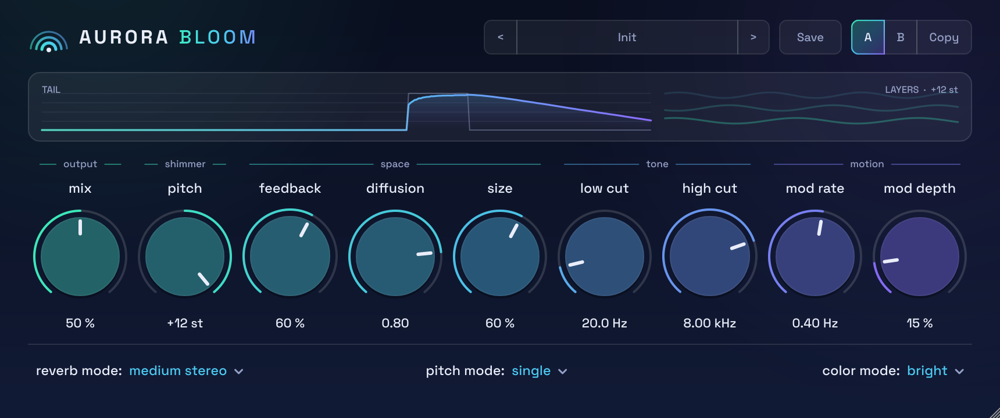

# Aurora Bloom

Reverb algorítmica estéreo con un **pitch shifter granular dentro del lazo de retroalimentación**
(efecto *shimmer*): cada recirculación vuelve a transponerse, así que con +12 st la cola va
apilando octavas ascendentes mientras crece la densidad de ecos. Plugin **VST3** (Windows/macOS),
**AU** (macOS) y **Standalone**, hecho con JUCE 8 y pensado ante todo para **FL Studio**.



- 4 modos de reverb (Mono, Big, Medium, Small), 5 modos de pitch (Single, Dual, Single Reverse,
  Dual Reverse, Bypass) y color Bright/Dark.
- Diffusion de 0 (delay ping-pong) a 1 (metálico), Feedback hasta colas casi infinitas y estable
  al 100 %.
- Latencia 0, < 3 % de CPU por instancia a 48 kHz, salida idéntica con cualquier tamaño de bloque.
- Interfaz vectorial redimensionable (75–200 %) con las 9 perillas en una sola fila y los tres
  modos como menús de texto; 12 presets de fábrica (también en el menú de presets de FL), presets
  de usuario y A/B.

---

## Instalación

Descarga el zip de tu sistema desde la página de **Releases** del repositorio (o desde los
artefactos de la última ejecución de *Actions*).

### Windows + FL Studio

1. Descomprime `AuroraBloom-Windows-VST3.zip`. Obtendrás la carpeta `Aurora Bloom.vst3`.
2. Cópiala a `C:\Program Files\Common Files\VST3\` (hace falta permiso de administrador).
3. Abre FL Studio → **Options → Manage plugins** → pulsa **Find installed plugins** (o *Find more
   plugins* si no aparece) y espera a que termine el escaneo.
4. Busca **Aurora Bloom** en la lista (categoría *Effects*), marca la estrella para añadirlo a
   favoritos.
5. En el **Mixer**, elige una pista (o mejor una pista de envío/*send*), haz clic en un slot vacío
   y selecciona **Aurora Bloom**.

El binario está enlazado con el runtime estático de MSVC (`/MT`): no necesita instalar el
*Visual C++ Redistributable*. Sólo se compila la versión de 64 bits (x64), la que usan las versiones actuales de FL Studio.

### macOS + FL Studio (o cualquier DAW)

1. Descomprime `AuroraBloom-macOS-VST3.zip` y/o `AuroraBloom-macOS-AU.zip`.
2. Copia `Aurora Bloom.vst3` a `~/Library/Audio/Plug-Ins/VST3/` y `Aurora Bloom.component` a
   `~/Library/Audio/Plug-Ins/Components/`.
3. Los builds de CI están firmados *ad hoc* pero no notarizados. Si macOS bloquea el plugin, quita
   la cuarentena:
   ```bash
   xattr -dr com.apple.quarantine ~/Library/Audio/Plug-Ins/VST3/"Aurora Bloom.vst3"
   xattr -dr com.apple.quarantine ~/Library/Audio/Plug-Ins/Components/"Aurora Bloom.component"
   ```
4. En FL Studio: **Options → Manage plugins → Find installed plugins**, y cárgalo en el Mixer como
   en Windows. El binario es universal (Apple Silicon e Intel), macOS 10.13 o posterior.

### Consejos para FL Studio

- Úsalo preferentemente en una pista de envío con **Mix al 100 %**, o en inserción con Mix 20–50 %.
- El plugin informa a FL de la duración de su cola, así que **Smart Disable** y el render no la
  cortan. Con Feedback al 100 % la cola es prácticamente infinita: usa *Leave remainder* al
  renderizar si quieres conservarla.
- El bypass del host (botón de la pista o del slot) deja pasar la señal seca y vacía la cola
  suavemente, sin clicks. Mientras está en bypass no consume CPU, y al reactivarlo la cola antigua
  no reaparece.
- Los 12 presets de fábrica aparecen también en el **menú de presets propio de FL** (la flecha de
  presets de la ventana del plugin), además de en el navegador del plugin.
- Hacer clic en las perillas no le quita el foco del teclado a FL: la barra espaciadora y los
  atajos siguen funcionando con la ventana del plugin abierta. Para controlar el plugin con el
  teclado, entra con **Tab**.
- Todos los parámetros son automatizables (*Browse parameters* / clic derecho → *Create automation
  clip*). Los modos aparecen con su nombre.
- El estado (parámetros, preset actual y tamaño de la ventana) se guarda en el proyecto `.flp` y en
  los presets `.fst` de FL.

---

## Parámetros

| Control | Rango | Por defecto | Qué hace |
|---|---|---|---|
| **Mix** | 0–100 % | 50 % | Balance seco/húmedo con ley de igual potencia (sonoridad constante). |
| **Pitch** | −12 a +12 st | +12 st | Transposición dentro del lazo. Arrastrar salta por semitonos; con **Shift**, pasos de 0,01 st. |
| **Feedback** | 0–100 % | 60 % | Cuánto vuelve a entrar al lazo (y al pitch shifter). Con 0 % el pitch no se oye; el último 10 % da colas casi infinitas (ver nota abajo). |
| **Diffusion** | 0,00–1,00 | 0,80 | Coeficiente de los allpass. 0 = delay ping-pong; ~0,62 = "bloom" lento; 0,8–0,9 = denso y largo; > 0,91 = metálico y más suave. |
| **Size** | 0–100 % | 60 % | Escala todas las líneas de retardo. Moverlo con la cola sonando dobla su afinación, como una cinta. |
| **Low Cut** | 10 Hz–2 kHz | 20 Hz | Pasa-altos dentro del lazo: cada pasada la cola es más fina y brillante. |
| **High Cut** | 500 Hz–20 kHz | 8 kHz | Pasa-bajos dentro del lazo: cada pasada la cola es más oscura (absorción del aire). |
| **Mod Rate** | 0,01–10 Hz | 0,40 Hz | Velocidad media de los moduladores aleatorios (uno por línea de retardo). |
| **Mod Depth** | 0–100 % | 15 % | Profundidad de modulación (0–64 muestras @ 48 kHz): chorus y desafinación, mayor con Diffusion alto. |
| **Reverb Mode** | Mono / Big Stereo / Medium Stereo / Small Stereo | Medium Stereo | Tamaño y densidad base. Mono suma L+R a la entrada y es el más grande. |
| **Pitch Mode** | Single / Dual / Single Rev / Dual Rev / Bypass | Single | Un shifter, dos (+/−), con granos invertidos (más suave, tipo órgano) o sin pitch. |
| **Color Mode** | Bright / Dark | Bright | Dark añade un pasa-bajos empinado (~10 kHz) dentro del lazo, estilo reverb digital vintage. |

> **Nota sobre colas infinitas.** Con Pitch en *Single* cada pasada sube toda la energía (p. ej. una
> octava), que acaba saliendo por High Cut: incluso con Feedback al 100 % la cola termina, cada vez
> más brillante. Para pads casi infinitos usa *Dual* / *Dual Reverse* (la energía sube y baja) o
> Pitch 0 / *Bypass*, con Low Cut bajo y High Cut alto.

### Interacción con la interfaz

- Las 9 perillas van en una fila, en el orden mix · pitch · feedback · diffusion · size · low cut ·
  high cut · mod rate · mod depth, agrupadas por pequeños rótulos (output, shimmer, space, tone,
  motion). Los tres modos están abajo como menús de texto (`reverb mode: medium stereo ▾`): clic
  para elegir, rueda del ratón o flechas para recorrer las opciones.
- **Arrastrar** vertical u horizontalmente · **Ctrl/Cmd + arrastrar** = ajuste fino (en Pitch,
  **Shift + arrastrar** también afina y desbloquea los pasos de 0,01 st).
- **Doble clic** = valor por defecto · **rueda del ratón** (Ctrl/Cmd = fino).
- **Clic en el valor** para escribirlo (acepta `8k`, `250 Hz`, `-7 st`, …).
- **Teclado**: Tab para moverse, flechas (Ctrl/Cmd = fino), Re Pág/Av Pág, Inicio/Fin, Supr = defecto.
- **Tooltips** en todos los controles.
- La ventana se redimensiona desde la esquina inferior derecha (75–200 %, proporción fija).

### Presets

Barra superior: `<` / `>` recorren los presets, el nombre abre el menú (*Init* para volver a los
valores por defecto, presets de fábrica y de usuario), **Save** guarda un preset de usuario en
`Documentos/Aurora Bloom/Presets/` (pide confirmación antes de sobrescribir uno existente) y
**A / B / Copy** permiten comparar dos ajustes. Un `*` junto al nombre indica cambios sin guardar.

| Preset | Categoría | Ajustes clave |
|---|---|---|
| Octave Halo | Shimmer | +12 st, Single, Medium, Feedback 74 %: el shimmer clásico de octava |
| Fifth Ascent | Shimmer | +7 st (quinta), Single, Medium |
| Undertow | Shimmer | −12 st, Single, Big: shimmer descendente |
| Celestial Organ | Shimmer | +12 st, Dual Reverse, Big: órgano celestial |
| Slow Bloom | Ambient | Diffusion 0,618: ataque lento y simétrico |
| Pitch Ping-Pong | Delay | Diffusion 0, Medium, +12 st: delay que sube de octava |
| Plain Hall | Reverb | Pitch Bypass: hall convencional |
| Dark Cathedral | Reverb | Big Stereo + Dark, Size 90 %, sin pitch |
| Choir Room | Ambient | Small Stereo, Dual, modulación alta: ambiente coral corto |
| Endless Pad | Ambient | Feedback 100 %, Dual Reverse, Big: pad casi infinito (~90 s hasta −60 dB) |
| Slapback Tile | Delay | Feedback 0, Small Stereo: slapback |
| Ferrite Memory | Vintage | Mono + Dark + Single Reverse: textura vintage |

---

## Compilar desde el código

Requisitos: CMake ≥ 3.25, compilador C++20 (Visual Studio 2022, Xcode 15+, GCC 12+ o Clang 15+) y
git. En Linux además: `libasound2-dev libx11-dev libxrandr-dev libxinerama-dev libxcursor-dev
libxcomposite-dev libxext-dev libfreetype-dev libfontconfig1-dev`.

```bash
git clone --recursive https://github.com/AlejandroMolinaDev/Valhalla_shimmer.git
cd Valhalla_shimmer
cmake -B build -DCMAKE_BUILD_TYPE=Release
cmake --build build --config Release --parallel
ctest --test-dir build -C Release --output-on-failure
```

Los binarios quedan en `build/AuroraBloom_artefacts/Release/{VST3,AU,Standalone}`. Por defecto
`COPY_PLUGIN_AFTER_BUILD` copia el plugin a la carpeta del sistema; en Windows eso requiere una
consola de administrador. Desactívalo con `-DAB_COPY_AFTER_BUILD=OFF`.

Opciones de CMake: `AB_BUILD_TESTS` (ON), `AB_COPY_AFTER_BUILD` (ON).

### Estructura

```
source/
  PluginProcessor.*  Parameters.*  PresetManager.*  PluginEditor.*
  dsp/   ShimmerEngine, DiffuserNetwork, ModulatedAllpass, ModulatedDelay, GrainPitchShifter,
         LoopFilters, RandomLfo, Smoothers, ReverbModes, Denormals  (C++ puro, sin JUCE)
  ui/    LookAndFeel, Knob, ModeSelector, DecayVisualizer, PresetBar
  presets/  presets de fábrica (XML embebidos)
assets/fonts/   Space Grotesk (SIL OFL 1.1)
tests/          Catch2: DspTests, PluginTests (+ KnobAudioTests, EditorTests), ab_render
tools/          spectrogram.py (análisis de renders)
docs/DSP.md     arquitectura y decisiones del DSP
```

### Tests

`DspTests` (motor puro) y `PluginTests` (plugin JUCE) cubren los 9 tests de la especificación y
más: estabilidad con ruido a Feedback 100 % en los 20 modos, decaimiento bajo −90 dBFS, retardo
puro con Diffusion 0, ausencia de pitch con Feedback 0, energía armónica Single vs Bypass, ley de
mezcla, RT60 independiente de la frecuencia de muestreo, salida idéntica con bloques variables,
guardado/restauración de estado, presets, A/B y patrones de llamada de FL Studio (bloques de 0
muestras, bloques mayores que el máximo, re-`prepare`, instancias en paralelo, bypass).

Además, dos baterías prueban el plugin completo tal como lo usa un host:

- **`KnobAudioTests.cpp`**: cada perilla y selector se prueba a través de los parámetros reales
  (APVTS → motor → `processBlock`) y se mide su efecto en el audio: Mix sigue la ley
  `cos(mix·π/2)`, Pitch lleva la cola al intervalo elegido (+12, +7, +5, −12, 0), Feedback alarga la
  cola, Diffusion pasa de ecos discretos a una nube densa, Size retrasa la primera llegada, Low/High
  Cut y Color Dark recortan graves/agudos, Mod Depth/Rate desafinan (y con Depth 0 Rate no cambia ni
  una muestra), Reverb Mode (Mono suma la entrada, cada modo suena distinto), Pitch Mode (cada modo
  genera sus intervalos). También: silencio digital → silencio, los 12 presets sin clipping, DC ni
  saltos de volumen, imagen estéreo decorrelada, cola reportada suficiente y **automatización
  extrema de cada perilla sin clicks**.
- **`EditorTests.cpp`**: abre el editor real y simula al usuario: cada perilla está ligada a su
  parámetro (en ambos sentidos), arrastre normal y fino (Ctrl/Cmd), snap de semitonos en Pitch
  (Shift = 0,01 st), doble clic, rueda, teclado, texto con unidades y valores tecleados, un único
  gesto por arrastre (para grabar automatización en FL Studio), selectores de modo sincronizados y
  sin solaparse, barra de presets (anterior/siguiente, menú, Init, marca `*`, A/B, Copy, guardar y
  reemplazar presets de usuario), visualizador que sigue la cola y se detiene oculto, render a todos
  los tamaños, disposición sin solapes y abrir/cerrar el editor con audio en otro hilo.

```bash
./build/tests/ab_render render.wav input=chord pitch=12 feedback=0.75 pitchmode=3 seconds=15
python3 tools/spectrogram.py render.wav -o render.png
```

### Integración continua

`.github/workflows/build.yml` compila en **Windows (MSVC, /MT)**, **macOS (universal)** y **Linux**,
ejecuta los tests, valida con **pluginval** (estrictez 10) y, en macOS, con **auval**; comprueba que
el `.vst3` de Windows no depende del runtime dinámico y sube los zips como artefactos.

Para publicar una versión: actualiza `VERSION`, haz merge a la rama principal y empuja un tag
`vX.Y.Z` (`git tag v1.0.0 && git push origin v1.0.0`). El job **release** crea el GitHub Release
con los binarios de las tres plataformas.

---

## Licencia

Aurora Bloom se distribuye bajo **AGPL-3.0** (ver `LICENSE`).

JUCE 8 está disponible bajo AGPLv3 o bajo licencia comercial de JUCE. Si quieres **distribuir el
plugin comercialmente o con código cerrado**, necesitas una licencia comercial de JUCE
(<https://juce.com/get-juce>). La fuente Space Grotesk se incluye bajo SIL Open Font License 1.1
(`assets/fonts/OFL.txt`). Catch2 (BSL-1.0) sólo se usa para los tests.

VST es una marca registrada de Steinberg Media Technologies GmbH. Audio Unit es una marca de Apple
Inc. FL Studio es una marca de Image-Line Software.
